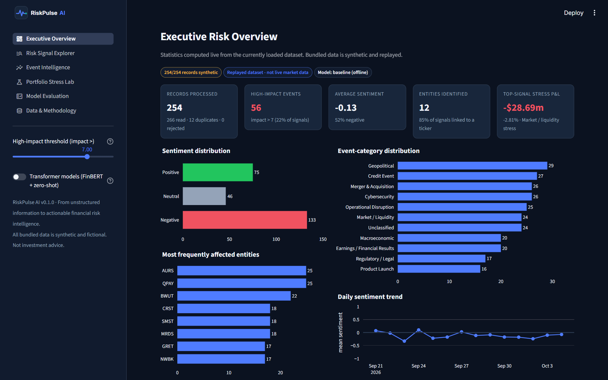
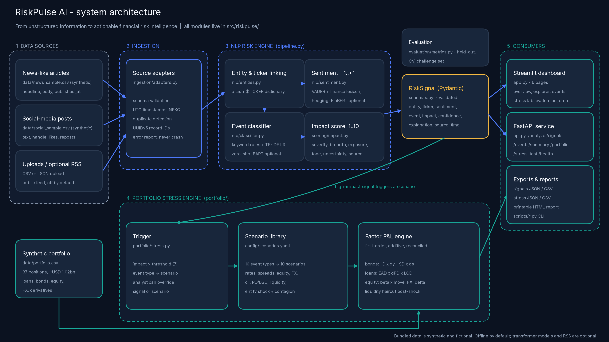

# RiskPulse AI - S&P Global & Crisil Campus Hackathon

**From Unstructured Information to Actionable Financial Risk Intelligence.**

**Candidate Name:** Mohit Kumar Gautam
**College Email ID:** _[to be added - college email ID]_
**College / Campus:** IIT Delhi
**Demo Video Link:** _[to be added after upload - YouTube (unlisted)]_
**Slide Deck Link (if hosted externally):** not hosted externally - see [`docs/presentation.pdf`](docs/presentation.pdf) (also [`docs/presentation.pptx`](docs/presentation.pptx))



## 1. Project Overview / Problem Statement & Approach

Risk teams in wholesale banking face a stream of news articles and social-media posts that is too large
to read, too noisy to trust, and disconnected from the portfolio. A negative tweet about a company logo is
noise; a missed coupon payment at a borrower is a credit event that should reach the risk book within
minutes. The challenge is to turn this unstructured text into **structured, explainable risk signals** and
to show **what a high-impact event would do to a portfolio**.

**RiskPulse AI** is an end-to-end, offline prototype. Two independent source adapters (news-like and
social-media-like, CSV or JSON) validate, normalise and de-duplicate records. An NLP engine links each
record to a company and ticker, scores sentiment from -1 to +1, classifies it into one of ten event types
(or abstains with *Unclassified*), and computes a transparent **impact score from 1 to 10** with a
confidence value and a plain-English explanation of every factor. Signals are exposed through a FastAPI
service, JSON/CSV exports and a six-page Streamlit dashboard.

The downstream application is **Module B - Strategic Portfolio Stress Testing**. When a signal's impact
exceeds a configurable threshold (default > 7), RiskPulse maps its event type to a scenario (e.g.
Geopolitical -> risk-off equities, lower yields, wider spreads, oil spike) and revalues a synthetic
~USD 1.02bn wholesale-banking book of loans, bonds, equities, FX and derivatives with explicit,
reconciling formulas (duration, spread duration, beta, delta, PD x LGD, liquidity haircuts). The dashboard,
API, CLI and printable report all use the same calculation engine.

## 2. Architecture & Tech Stack



Data sources -> ingestion adapters -> validation & normalisation -> duplicate detection -> entity
extraction -> sentiment -> event classification -> impact scoring -> validated `RiskSignal` -> API &
exports -> portfolio stress engine -> dashboard & reports. (Mermaid source: [`docs/architecture.mmd`](docs/architecture.mmd).)

| Layer | Choice | Why |
|---|---|---|
| Language | Python 3.11 | data/ML ecosystem |
| Data | pandas, NumPy | tabular processing |
| Sentiment | VADER + 116-term finance lexicon, phrase rules, hedge dampening | transparent, offline, fast; FinBERT optional |
| Event classifier | weighted keyword rules + scikit-learn TF-IDF / logistic regression | auditable evidence + learned generalisation; BART-MNLI zero-shot fallback optional |
| Schema | Pydantic v2 | range/category/timestamp validation of every signal |
| API | FastAPI + Uvicorn | typed REST for downstream systems |
| Dashboard | Streamlit + Plotly | interactive analytics; custom RiskPulse design system |
| Config | YAML (`config/scoring.yaml`, `config/scenarios.yaml`) | weights and shocks editable without code |
| Tests | pytest, FastAPI TestClient, Streamlit AppTest | 93 automated tests |
| Docs build | matplotlib, python-pptx, PyMuPDF, Playwright | diagram, deck, screenshots (optional) |

No database is required: signals are recomputed deterministically in about 4 seconds and exported as
JSON/CSV. No proprietary model or API key is used anywhere.

```
riskpulse-ai/
├── app.py                  Streamlit dashboard (6 pages)
├── api.py                  FastAPI service
├── config/                 scoring.yaml (impact weights), scenarios.yaml (stress scenarios)
├── src/riskpulse/
│   ├── ingestion/          news / social / RSS adapters, validation, dedupe, IDs
│   ├── nlp/                entities, sentiment, classifier, optional transformers
│   ├── scoring/            impact score
│   ├── portfolio/          portfolio model, stress engine, HTML report
│   ├── evaluation/         metrics (held-out, CV, challenge set)
│   ├── pipeline.py         end-to-end engine + exports
│   ├── schemas.py          Pydantic contracts
│   └── ui.py               design tokens, CSS, Plotly theme
├── data/                   all synthetic inputs + generated outputs (see data/README.md)
├── scripts/                generate data, run pipeline, evaluate, stress test, build docs
├── tests/                  pytest suite
└── docs/                   presentation, architecture, methodology, model card, demo script, reports
```

## 3. Dataset Used

- **Source / nature: 100% synthetic, generated for this project.** The organisers supplied only the
  submission-guidelines PDF (no transaction file or sample dataset), so `scripts/generate_demo_data.py`
  (seed 42) produces: 126 news-like articles, 140 social-media-like posts (including 10 reposts to test
  de-duplication), a 628-row labelled validation set from 157 hand-written templates, a 44-row
  hand-written challenge set, and a 37-position portfolio.
- All companies (Northwind Bank, Helix Energy Corp, Meridian Shipping, ...) and tickers are **fictional**.
  No real, proprietary or confidential data, and nothing from S&P Global, Crisil or any client, is used.
  Every record is labelled `is_synthetic = true`.
- **Assumptions:** naive timestamps are UTC; portfolio amounts, ratings, PDs, LGDs and durations are
  illustrative; stress shocks are expert-set. Full data dictionary: [`data/README.md`](data/README.md).
- Optional: a user-supplied public RSS feed can be ingested (off by default; such records are marked
  non-synthetic). The demo never needs network access.

## 4. Quickstart & Installation

Runtime: **Python 3.11** (tested with 3.11.9) on **Windows 11**; dependencies are pure-Python wheels
and should work on macOS/Linux.

```bash
git clone https://github.com/mohit-gautam7/iit-delhi-mohit-kumar-gautam-hackathon.git
cd iit-delhi-mohit-kumar-gautam-hackathon
python -m venv .venv
# Windows: .venv\Scripts\activate      macOS/Linux: source .venv/bin/activate
pip install -r requirements.txt
streamlit run app.py
```

Open http://localhost:8501. The bundled synthetic data loads automatically.

**API** (second terminal):

```bash
uvicorn api:app --port 8000
```

Interactive docs: http://localhost:8000/docs. Example:

```bash
curl -X POST http://localhost:8000/analyze -H "Content-Type: application/json" \
  -d '{"items":[{"text":"Meridian Shipping missed a coupon payment and was downgraded to CCC","source_type":"news"}]}'
```

| Route | Purpose |
|---|---|
| `GET /health` | status, counts |
| `GET /signals` | filter by `event_type`, `ticker`, `sentiment_label`, `source_type`, `min_impact`, `limit` |
| `GET /signals/{signal_id}` | one signal |
| `POST /analyze` | analyse up to 100 texts (`store: true` adds them to the signal store) |
| `GET /events/summary` | counts, averages, top entities, recent high-impact events |
| `GET /portfolio` | synthetic holdings, composition, scenario list |
| `POST /stress-test` | by `signal_id` (auto scenario) or `scenario_key` + `impact_score` + `ticker`; optional `overrides`, `threshold`, `scale_with_impact` |

Real responses are saved in [`docs/api_examples/`](docs/api_examples/). Invalid input returns 422,
unknown IDs 404.

**Command-line pipeline**

```bash
python scripts/generate_demo_data.py   # regenerate synthetic inputs (deterministic)
python scripts/run_pipeline.py         # -> data/sample_signals.json/.csv, data/ingestion_report.json
python scripts/evaluate_model.py       # -> data/evaluation_report.json
python scripts/run_stress_test.py      # -> data/stress_result.json, data/stress_positions.csv, docs/stress_report.html
python scripts/run_stress_test.py --scenario macro_rates_shock --impact 9
python -m pytest                       # 93 tests
```

**Optional transformer mode** (FinBERT + zero-shot fallback; ~2-3 GB download, slower on CPU):

```bash
pip install -r requirements-transformers.txt
```

then enable *Transformer models* in the dashboard sidebar or run `python scripts/run_pipeline.py --transformers`.

**Stress-test walkthrough:** open **Portfolio Stress Lab** -> the top auto-triggered signal is pre-selected
(impact > threshold) -> the mapped scenario and its assumptions are shown -> edit any shock under
*Edit stress assumptions* -> review before/after value, P&L waterfall by risk factor, asset-class losses
and position-level results -> download JSON, CSV or the printable HTML report. Toggle *Choose from all
signals* to run any signal or scenario manually.

## 5. Key Results & Domain Impact

**What the prototype outputs (bundled data, reproducible):**

| Result | Value |
|---|---|
| Records ingested -> signals | 266 rows -> 254 signals (12 duplicates removed, 0 rejected) |
| High-impact signals (impact > 7) | 56 |
| Top auto-triggered stress | *Market / Liquidity* signal, impact 10 -> Market / liquidity stress: **$1,019.10m -> $990.41m, P&L -$28.69m (-2.81%)** |
| Entity-specific stress | Meridian Shipping credit event (impact 9): P&L -$12.47m (-1.22%); CDS hedge +$3.26m |
| P&L reconciliation | components = positions = asset classes = total (asserted in code and tests) |
| Automated tests | **93 passed** (see [`docs/test_report.md`](docs/test_report.md)) |

Example signal (from `data/sample_signals.json`):

```json
{
  "entity": "Meridian Shipping", "ticker": "MRDS", "source_type": "news",
  "event_type": "Credit Event", "sentiment_score": -1.0, "sentiment_label": "Negative",
  "impact_score": 9, "confidence": 0.998,
  "explanation": "Classified as Credit Event (classifier confidence 1.00; keywords 'default', 'downgrades', 'missed a coupon', ...). ... Impact 9/10: base 6.5 + intensity 0.5 + portfolio exposure 0.8 + sentiment strength 1.5 = 9.3. High impact (> 7): eligible to trigger a portfolio stress test.",
  "is_synthetic": true
}
```

**Model evaluation (synthetic data - see [`docs/model_card.md`](docs/model_card.md)):**

| Metric | Value |
|---|---|
| Event classifier, template-grouped hold-out (hybrid) | accuracy 0.994, macro-F1 0.993; 4-fold grouped CV macro-F1 0.976 +/- 0.018 |
| Event classifier, 44 hand-written paraphrases | baseline 22.7% -> **68.2%** with optional zero-shot fallback |
| Sentiment accuracy (628 labelled rows) | naive VADER 57.5% -> finance-adapted 70.4% -> FinBERT (optional) 82.3% |

The held-out scores are optimistic because the rules and templates share an author; the challenge set
is the honest generalisation test and is reported on purpose.

**Why it matters:**
- **Early warning:** minutes from a headline to a quantified exposure, instead of hours of reading.
- **Explainability:** every score shows its keywords, drivers and arithmetic, so analysts can audit and
  challenge it - essential for model-risk governance.
- **Portfolio relevance:** impact accounts for actual exposure, and the stress engine translates the event
  into P&L by asset class and position (including hedges such as CDS protection).
- **Integration:** the REST API and CSV/JSON outputs can feed limit monitoring, credit-review queues and
  alerting.

**Limitations:** synthetic validation only; baseline classifier generalises poorly to unseen phrasing
(mitigated by the optional zero-shot fallback); impact weights and shocks are not calibrated to historical
market reactions; first-order stress maths (no convexity, gamma/vega or full loan revaluation);
dictionary entity linking over a fixed fictional universe. Details:
[`docs/methodology.md`](docs/methodology.md).

## Documentation

| Document | Content |
|---|---|
| [`docs/presentation.pdf`](docs/presentation.pdf) / [`.pptx`](docs/presentation.pptx) | 7-slide deck |
| [`docs/methodology.md`](docs/methodology.md) | all formulas, scenarios, assumptions, worked example |
| [`docs/model_card.md`](docs/model_card.md) | models, evaluation protocol, results, limitations |
| [`docs/demo_script.md`](docs/demo_script.md) | 5-minute demo with timings and contingency plan |
| [`docs/test_report.md`](docs/test_report.md) | test inventory and actual results |
| [`docs/completion_report.md`](docs/completion_report.md) | what was built and verified, remaining steps |
| [`data/README.md`](data/README.md) | data dictionary and synthetic-data disclosure |

## AI usage & academic integrity

This is an individual submission. AI coding assistance (Claude Code) was used to help write code,
documentation and the slide-deck generator; the problem framing, design choices, synthetic-data design,
evaluation protocol and all reported results were reviewed by the candidate and are reproducible from this
repository. No pre-existing project or third-party code base was copied; open-source libraries are used
under their licences.

## License

[MIT](LICENSE) © 2026 Mohit Kumar Gautam
